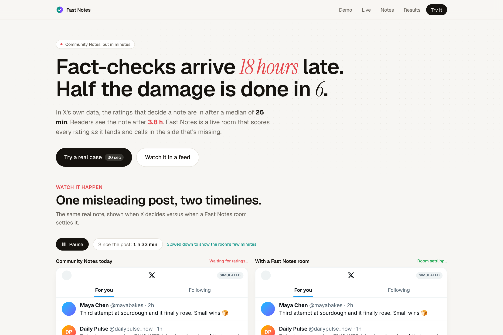
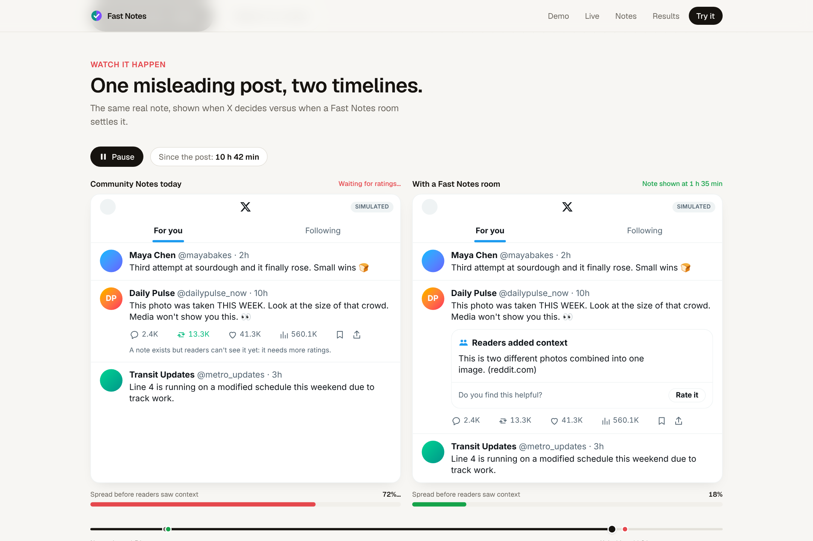
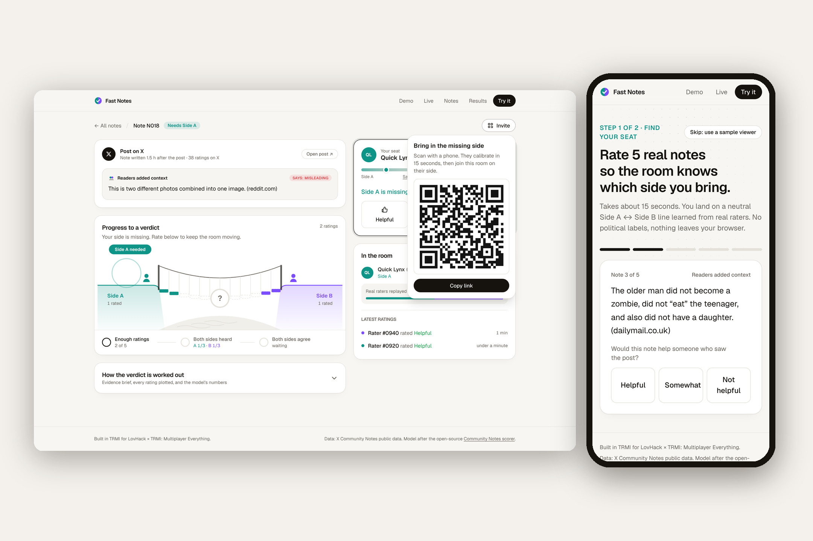
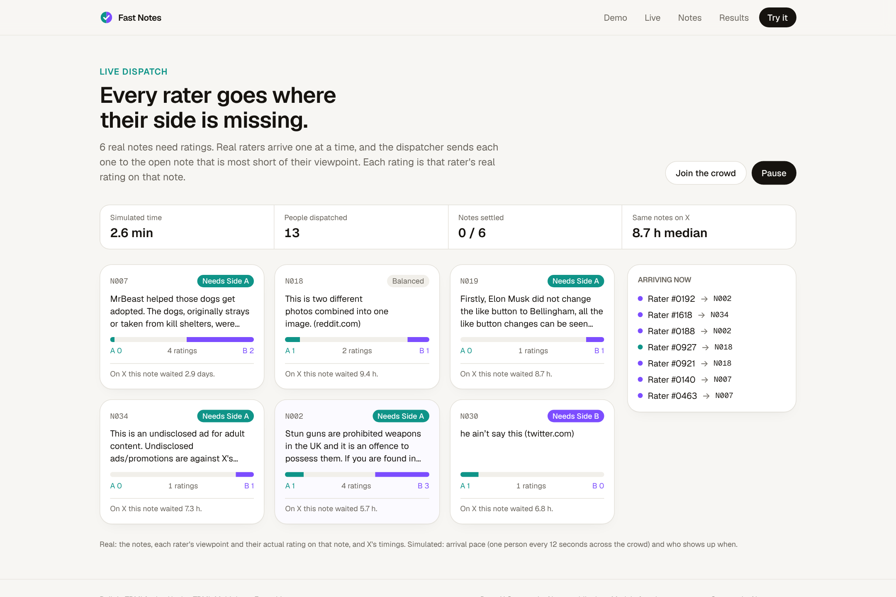

# Fast Notes

Crowd fact-checks that arrive while a post is still spreading.

**Live app: [fast-notes-nine.vercel.app](https://fast-notes-nine.vercel.app/)**



| Two timelines | Multiplayer by QR | Live dispatch |
|---|---|---|
|  |  |  |

Built as a team in TRMI: see [docs/trmi/](docs/trmi/) (the shared project with both of us in the call, Claude's commits in the Git graph, and the plan and pipeline run).

> Built for **LovHack x TRMI: Multiplayer Everything**. Write-up: [docs/DEVPOST.md](docs/DEVPOST.md) (every number in it is generated from the data files).

**Try it:** the Live page dispatches real raters across six notes at once. Open a room alone and real raters' real ratings replay as bots. Or press **Invite**, scan the QR code with a phone, and become the side the note is missing.

## The problem

- X Community Notes take a median **18.1 h** from post to note display. Half of reposts happen within **5.75 h**, and only **13.5%** of helpful notes are shown by then. Notes cut total reposts by **15.3%**; showing them at hour 2 would cut them by **53.1%**. ([Chuai et al., arXiv:2409.08781](https://arxiv.org/abs/2409.08781))
- Of ~1.8M notes, only **11.5%** ever reach consensus. Median **6.2 h** from note to helpful status; median **15.3 h** from post to first helpful note. ([Razuvayevskaya et al., arXiv:2510.12559](https://arxiv.org/abs/2510.12559))

## Layout

| Path | What |
|---|---|
| `pipeline/` | Python: data sampling, bridging matrix factorisation, rating-order replay, export |
| `web/` | Next.js app (rooms, calibration, results) |
| `schemas/` | JSON Schemas for `web/public/data/{showcase_notes,raters,results}.json` |
| `data/raw/` | Community Notes downloads (git-ignored) |

## Built in TRMI

We built Fast Notes as a two-person team inside [TRMI](https://trmi.dev), the multiplayer IDE, working in the same TRMI room the whole weekend.

<!-- Debi: replace each placeholder with a real screenshot in docs/trmi/ -->

| What | Screenshot |
|---|---|
| Both of us editing the room page live in one TRMI room | `docs/trmi/shared-room.png` *(add)* |
| TRMI's agent running the data pipeline while we reviewed the output | `docs/trmi/agent-pipeline.png` *(add)* |
| Splitting work: data + model (teammate A) and live app (teammate B) | `docs/trmi/work-split.png` *(add)* |

How we split the work in TRMI:

- **Teammate A:** data pipeline, bridging model, replay experiment, Results page.
- **Teammate B:** live room, Supabase realtime, calibration, landing page.
- **Together:** the JSON schemas both halves build against, the demo and the write-up.

## Data files

`web/public/data/*.json` currently hold **mock** data (`"isMock": true`), generated by `pipeline/make_mock.py`, so the web app can be built before the real pipeline runs.

```powershell
py -m venv pipeline\.venv
pipeline\.venv\Scripts\python.exe -m pip install -r pipeline\requirements.txt
cd pipeline; ..\pipeline\.venv\Scripts\python.exe make_mock.py; cd ..
pipeline\.venv\Scripts\python.exe pipeline\validate_data.py
```

### Real data

One command on Windows (download, sample, fit, replay, validate, regenerate `docs/DEVPOST.md`, commit):

```powershell
powershell -ExecutionPolicy Bypass -File pipeline\run_real.ps1
```

Or step by step:

```powershell
pipeline\.venv\Scripts\python.exe pipeline\download.py --ratings 1      # notes, status history, 1 ratings file -> data/raw/
pipeline\.venv\Scripts\python.exe pipeline\build_real.py --max-notes 1000 # sample, fit, replay, export (isMock=false)
pipeline\.venv\Scripts\python.exe pipeline\validate_data.py
```

If `download.py` can't find a snapshot, download the files by hand from <https://x.com/i/communitynotes/download-data> into `data/raw/` (zip or tsv). `build_real.py` streams the ratings file in 2M-row chunks, so one ratings file fits in a laptop's memory. It prints the model's agreement with X's real statuses. Report that number as it comes out.

Model inspired by the open-source [Community Notes scorer](https://github.com/twitter/communitynotes).
